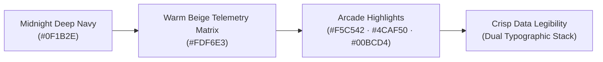
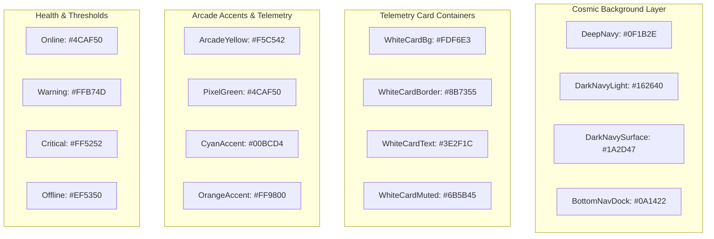
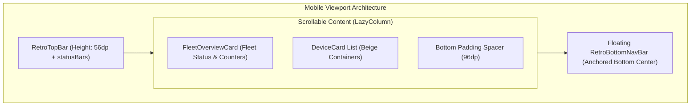

# Nexus UI Design System Specification (`DESIGN.md`)

> **Normative Reference**: All UI screens, composables, color references, and typographic hierarchy across the **Nexus** fleet monitoring Android client (Kotlin + Jetpack Compose) MUST strictly adhere to the tokens and architectural standards documented below.

---

## 1. Overview

### Creative North Star: *The 8-Bit Cyber-Terminal*
Nexus is a hardware telemetry platform designed for personal computer fleets (Windows workstations, Linux servers, and Raspberry Pis). The design language synthesizes the nostalgic mechanical charm of **1980s arcade CRT terminals** with the **high-density data requirements of modern sysadmin dashboards**.



### Core Design Pillars

1. **High-Density Scanability**: Telemetry cards are optimized for immediate comprehension in high-stress thermal or load situations. Key metrics (CPU %, Package Temp, GPU Clock, VRAM, and Battery State) are prominent without clutter.
2. **Dual Typographic Harmony**:
   * *Display & Badges*: 8-bit bitmap font (`Press Start 2P`) provides vintage computer terminal character.
   * *Telemetry & Body*: Clean, high-legibility system sans-serif prevents cognitive fatigue and guarantees legibility down to 10sp on compact mobile screens.
3. **Tactile Retro-Mechanical Surfacing**:
   * Rejection of arbitrary Gaussian blurs and soft drop-shadows.
   * Utilization of hard-edged 1.5dp–2dp pixel borders, inset bevels, and dual-tone card containers.
4. **Warm Beige on Deep Cosmos Contrast**:
   * High-contrast warm cream/beige cards (`#FDF6E3`) pop forward against deep arcade navy (`#0F1B2E`), creating an organic parchment-on-screen aesthetic reminiscent of classic diagnostic readouts.

---

## 2. Colors

### Palette Architecture & Semantic Mapping



### Color Specification Table

| Token Name | Hex Code | Compose Reference | Semantic Role / Application |
| :--- | :--- | :--- | :--- |
| **`bg-deep-navy`** | `#0F1B2E` | `DeepNavy` | Universal canvas background; screen surface |
| **`bg-navy-light`** | `#162640` | `DarkNavyLight` | Input backgrounds, inactive dock slots, secondary containers |
| **`bg-navy-surface`** | `#1A2D47` | `DarkNavySurface` | Modals, elevated dialogs, card backdrops |
| **`bg-nav-dock`** | `#0A1422` | `BottomNavBackground` | Persistent bottom floating navigation dock |
| **`container-beige-bg`** | `#FDF6E3` | `WhiteCardBg` / `CardBackground` | Primary device cards, detail matrix panels, charts |
| **`container-beige-border`**| `#8B7355` | `WhiteCardBorder` | 1.5dp border framing beige telemetry cards |
| **`container-beige-text`** | `#3E2F1C` | `WhiteCardText` | Primary typography inside beige cards |
| **`container-beige-text-muted`**|`#6B5B45`| `WhiteCardTextSecondary` | Metric labels, subheaders, timestamps inside beige cards |
| **`accent-arcade-yellow`**| `#F5C542` | `ArcadeYellow` | Primary CTA, active dock indicator, warning highlight |
| **`accent-pixel-green`** | `#4CAF50` | `PixelGreen` / `OnlineGreen` | Online status beacon, normal thermal levels, confirm |
| **`accent-cyan`** | `#00BCD4` | `CyanAccent` | GPU metric badge, link highlights, storage gauges |
| **`accent-orange`** | `#FF9800` | `OrangeAccent` | Elevated load alert, elevated memory utilization |
| **`status-critical`** | `#FF5252` | `CriticalRed` | Thermal throttling ($\ge 90^\circ\text{C}$), critical disk space |
| **`status-offline`** | `#EF5350` | `OfflineRed` | Offline device indicator, stale telemetry warning |
| **`text-white`** | `#FFFFFF` | `TextWhite` | High-contrast headers on dark navy surfaces |
| **`text-gray`** | `#B0BEC5` | `TextGray` | Subtitles, helper text on dark navy surfaces |
| **`border-pixel`** | `#2A3F5F` | `PixelBorderColor` | Standard 1dp–2dp pixel boundary lines and dividers |

---

## 3. Typography

### Dual-Engine Typography System

Nexus pairs **Press Start 2P** (bitmap aesthetic) with **System Sans / Inter** (high legibility):

```
┌────────────────────────────────────────────────────────┐
│  [PRESS START 2P]  →  PAGE TITLES, KPIS, STATUS BEACONS│
│  [Inter / Sans]    →  METRICS, CORE CLOCKS, PROCESSES  │
└────────────────────────────────────────────────────────┘
```

### Typographic Hierarchy & Scale

| Style Token | Font Family | Size | Weight | Line Height | Usage Context |
| :--- | :--- | :--- | :--- | :--- | :--- |
| **`displayLarge`** | `PixelFontFamily` | 18sp | Bold | 26sp | App branding, splash screen title |
| **`displayMedium`** | `PixelFontFamily` | 15sp | Bold | 22sp | Section titles ("DEVICES", "OVERVIEW") |
| **`displaySmall`** | `PixelFontFamily` | 12sp | Bold | 18sp | Device card name header, KPI numbers |
| **`headlineLarge`** | `PixelFontFamily` | 13sp | Bold | 20sp | Top bar navigation headers |
| **`headlineMedium`** | `PixelFontFamily` | 11sp | Bold | 16sp | Modal / dialog titles, alert titles |
| **`titleLarge`** | `ReadableFontFamily`| 16sp | Bold | 22sp | Process names, setting category headings |
| **`titleMedium`** | `ReadableFontFamily`| 14sp | SemiBold | 20sp | Telemetry chip headers, dialog body headers |
| **`bodyLarge`** | `ReadableFontFamily`| 14sp | Normal | 20sp | Informational body copy, instructions |
| **`bodyMedium`** | `ReadableFontFamily`| 13sp | Normal | 18sp | Detailed hardware specifications, specs |
| **`bodySmall`** | `ReadableFontFamily`| 11sp | Normal | 15sp | Process memory MB, secondary metrics |
| **`labelLarge`** | `ReadableFontFamily`| 12sp | Bold | 16sp | Button labels, interactive chip text |
| **`labelMedium`** | `ReadableFontFamily`| 11sp | SemiBold | 14sp | Bottom navigation tab labels |
| **`labelSmall`** | `ReadableFontFamily`| 10sp | Medium | 13sp | Micro-timestamps ("2m ago"), badge labels |

---

## 4. Layout

### Grid, Spatial Hierarchy & Dimensions

All layout spacing adheres to an **8dp rhythmic baseline** (with 4dp sub-steps):

* **Horizontal Screen Margin**: `16dp` standard, `24dp` on onboarding/pairing views.
* **Vertical Spacing Rhythm**:
  * Component micro-gap: `4dp` – `8dp`
  * Related item spacing: `12dp` – `14dp`
  * Section separation: `24dp` – `32dp`
* **Floating Bottom Dock Clearance**: All scrollable lists (`LazyColumn`) MUST end with a spacer of `96dp` to prevent the bottom navigation dock from occluding interactive elements.

### Layout Topology



### Screen Templates

1. **Dashboard (HomeScreen)**:
   * Fixed header with pixel cat emblem, current user identity, and live socket status.
   * `FleetOverviewCard`: High-level aggregate (total devices, active streaming, offline).
   * Vertical list of `DeviceCard` components.
2. **Device Details (DeviceDetailsScreen)**:
   * Hero thermal/utilization summary.
   * Telemetry Category Grid (CPU, RAM, GPU, Disks, Battery).
   * Process List Table (Top 5 memory consumers with MB values).
   * History Chart (1h, 6h, 24h interactive tab switch).
3. **Pairing & Scanner (QRScanScreen & ManualPairingScreen)**:
   * CameraX active viewfinder framed by neon retro crosshairs.
   * Fallback 6-digit block input supporting custom keyboard entry.

---

## 5. Elevation & Depth

### The Zero-Blur Principle
In traditional modern UI design, depth is expressed through fuzzy Gaussian drop shadows. In the **Nexus 8-Bit Retro** design system:

> [!IMPORTANT]
> **Gaussian drop shadows are strictly prohibited.** Depth is achieved exclusively through **color contrast layering**, **hard pixel borders**, and **inset highlight bevels**.

### Elevation Stack

```
Level 4: Modal Overlays / QR HUD Brackets (Border: 2dp CyanAccent, Scrim: 60% Black)
    Level 3: Floating Dock (Bg: #0A1422, Border: 1.5dp PixelBorderColor, Radius: 16dp)
        Level 2: Telemetry Cards (Bg: #FDF6E3, Border: 1.5dp #8B7355, Radius: 8dp)
            Level 1: Sub-panels / Input Boxes (Bg: #162640, Border: 1dp PixelBorderColor)
                Level 0: Root Canvas (Bg: #0F1B2E)
```

---

## 6. Shapes

### Radius Token Hierarchy

| Shape Token | Radius | Compose Implementation | Usage |
| :--- | :--- | :--- | :--- |
| **`PixelShape`** | `2dp` | `RoundedCornerShape(2.dp)` | Micro-badges, chart dot markers, status squares |
| **`RetroChipShape`** | `4dp` | `RoundedCornerShape(4.dp)` | Metric chips, filter tags, core pills |
| **`RetroButtonShape`**| `6dp` | `RoundedCornerShape(6.dp)` | Buttons, input text fields |
| **`RetroCardShape`** | `8dp` | `RoundedCornerShape(8.dp)` | Primary device containers, summary cards |
| **`FloatingDockShape`**| `16dp`| `RoundedCornerShape(16.dp)`| Bottom floating navigation dock |
| **`BeaconShape`** | `50%` | `CircleShape` | Online/Offline pulsing status dots |

### Border Styles
* **Card Border**: `1.5.dp` solid `WhiteCardBorder` (`#8B7355`).
* **Active Focus Border**: `2.dp` solid `PixelGreen` (`#4CAF50`) or `ArcadeYellow` (`#F5C542`).
* **Divider / Grid Line**: `1.dp` solid `PixelBorderColor` (`#2A3F5F`).

---

## 7. Components

### 1. `DeviceCard`
* **Surface**: `WhiteCardBg` (`#FDF6E3`) with `1.5dp` border (`#8B7355`).
* **Header**: Device icon (laptop/desktop/server), device hostname in `displaySmall` pixel font, and pulsing online/offline beacon (`OnlineGreen` / `OfflineRed`).
* **Metric Chips**: 4-column horizontal grid:
  1. *CPU*: Package temperature (°C) or utilization fallback (%).
  2. *GPU*: Core temperature (°C) and utilization.
  3. *RAM*: Used memory percentage (%).
  4. *Battery*: Battery percentage and charging lightning bolt.
* **Interaction**: Ripple feedback with instantaneous detail screen navigation.

### 2. `RetroButton`
* **Variants**:
  * `Primary`: Background `ArcadeYellow` (`#F5C542`), Text `DeepNavy` (`#0F1B2E`), Font `PixelFontFamily`.
  * `Secondary`: Background `DarkNavyLight` (`#162640`), Border `2dp` `PixelBorderColor`, Text `TextWhite`.
  * `Danger`: Background `CriticalRed` (`#FF5252`), Text `TextWhite`.
  * `Ghost`: Transparent background, Border `1dp` `PixelBorderColor`.
* **State Behavior**: Visually depresses by `2dp` on click (`animateDpAsState`).

### 3. `RetroProgressBar`
* Stepped segmented progress indicator composed of discrete pixel cells.
* Dynamic threshold color grading:
  * $0\% - 75\%$: `PixelGreen` (`#4CAF50`)
  * $76\% - 89\%$: `WarningOrange` (`#FFB74D`)
  * $\ge 90\%$: `CriticalRed` (`#FF5252`)

### 4. `RetroChart`
* Stepped retro line chart with dark navy grid lines and high-contrast plotted curves.
* Supports 1h, 6h, and 24h summary buckets fetched from Convex backend.

### 5. `RetroBottomNavBar`
* Floating pill dock anchored at bottom-center:
  * Background: `BottomNavBackground` (`#0A1422`) with `1.5dp` `PixelBorderColor` outline.
  * Selected Item: Highlighted with `ArcadeYellow` background block and dark icon.
  * Unselected Items: Inactive `TextGray` icons with subtle hover/press glow.

### 6. `AppLogo`
* Authentic 8-bit retro sprite showing a stylized CRT computer terminal with a pixel-art cat companion.
* Subtle CRT scanline animation applied on splash and pairing views.

---

## 8. Do's and Don'ts

| Category | Do | Don't |
| :--- | :--- | :--- |
| **Color** | Use `WhiteCardBg` (`#FDF6E3`) for all hardware telemetry cards to maintain the signature high-contrast terminal aesthetic. | Never use pure white (`#FFFFFF`) or generic grey cards that look like standard Material 3 templates. |
| **Typography** | Reserve `PixelFontFamily` (`Press Start 2P`) exclusively for headers, titles, and key metrics. | Never render multi-line paragraphs, process tables, or small labels in `PixelFontFamily` (causes illegibility). |
| **Elevation** | Use crisp `1.5dp` or `2dp` borders with solid tonal backgrounds for hierarchy. | Never apply blurry Gaussian box-shadows or glow halos that violate the retro bitmap aesthetic. |
| **Hardware Data** | Display genuine hardware readings (or `"--"` fallback when sensors are inactive/unsupported). | Never inject fake or random mock telemetry data into the live user views. |
| **Layout** | Ensure a `96dp` bottom spacer is present on all scrollable screens so content clears the floating dock. | Never allow content to be trapped behind the floating bottom navigation bar. |
| **Branding** | Maintain brand neutrality: use generic device terms (e.g. "Workstation", "Laptop", "Server") in public templates. | Never commit proprietary personal machine names or developer signatures into repository files. |
