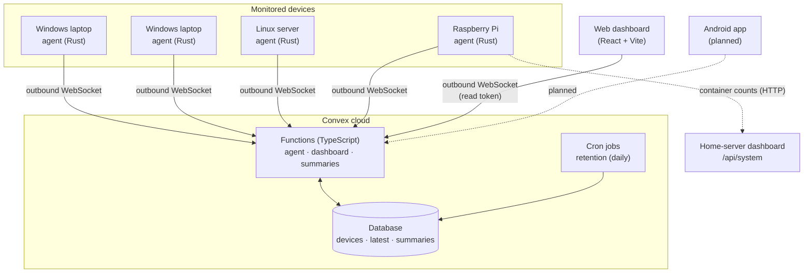
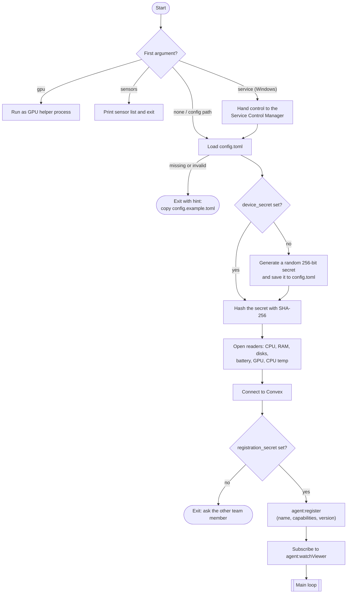
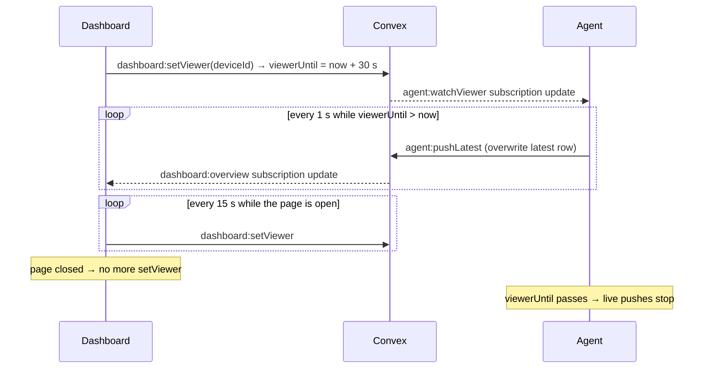
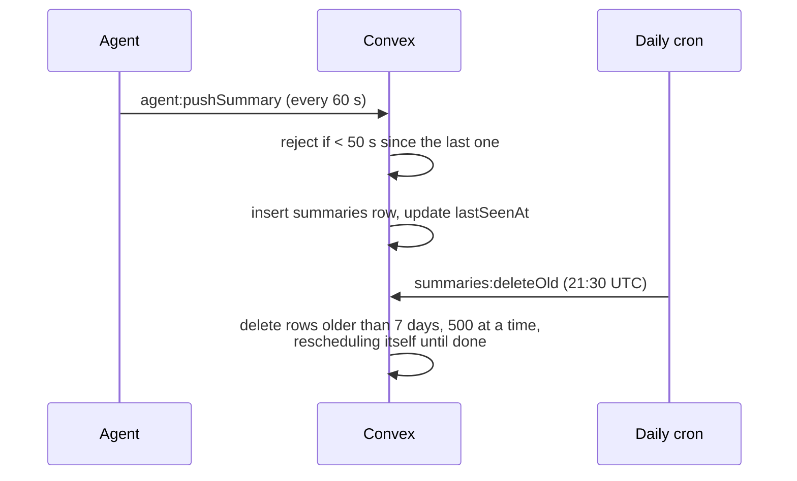
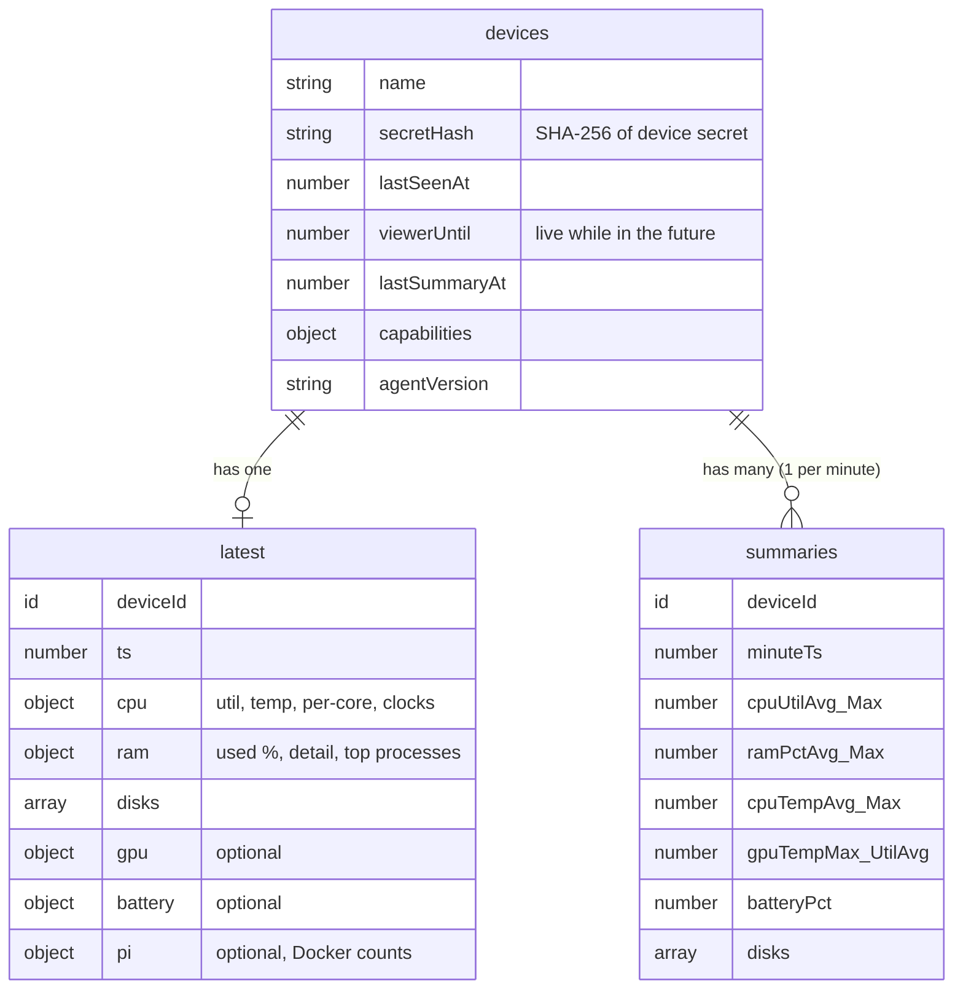

# Nexus

A lightweight hardware monitor for a small fleet of personal machines: Windows laptops, a Linux home server and a Raspberry Pi. A small Rust **agent** runs on each machine and reports to a **Convex** cloud backend, and a web **dashboard** shows every device live. An Android app with push alerts is planned.

**Status:** Week 1 (spikes). MVP due 3 Dec 2026.

---

## Contents

- [Why it exists](#why-it-exists)
- [Architecture](#architecture)
- [How it works](#how-it-works)
- [Components in detail](#components-in-detail)
- [Data model](#data-model)
- [Getting started](#getting-started)
- [Security](#security)
- [Project layout](#project-layout)
- [Roadmap](#roadmap)
- [Licence](#licence)

---

## Why it exists

Checking temperatures, load or battery means sitting at each machine. When a machine overheats or goes offline while nobody is at home, nobody knows. Nexus puts every machine on one screen and, once alerts land, tells you when something goes wrong.

Design goals:

- **Tiny footprint.** The agent is a single headless Rust binary that sends almost nothing while nobody is watching.
- **No server to run, no ports to open.** Every connection is *outbound* to Convex, so CGNAT and blocked port forwarding don't matter.
- **Live when you look, quiet when you don't.** Per-second data flows only while someone is viewing that device, which keeps Convex usage inside the free quota.

---

## Architecture



| Layer | Tech | Role |
|---|---|---|
| Agent | Rust, Tokio, `sysinfo`, `nvml-wrapper`, Convex Rust client | Samples hardware every second, pushes live data and per-minute summaries |
| Backend | Convex (TypeScript) | Stores devices, latest snapshot and history; tracks who is watching; deletes old data |
| Dashboard | React, Vite, Convex React client | Live view of every device, plus 1 h / 6 h / 24 h history charts |
| Android app | Planned | Fleet view, pairing and push alerts (FCM) |

---

## How it works

### 1. Agent startup



### 2. Main loop (runs every second)

Each tick the agent takes one sample. It always feeds the per-minute summary, and it only sends the full live snapshot when someone is watching.


How often each reading is taken:

| Reading | While live | While idle |
|---|---|---|
| CPU %, RAM %, CPU temp | every 1 s | every 1 s (summary only) |
| GPU (NVIDIA) | every 1 s via a streaming helper | every 30 s via a one-shot helper |
| Top processes | every 5 s | not read |
| Drives | every 10 s | before each summary |
| Battery | every 10 s | every 10 s |
| Docker counts (Pi) | every 10 s | every 10 s |
| Summary push | every 60 s | every 60 s |

### 3. Live view

The dashboard tells Convex someone is watching. Convex passes that on to the agent, and the agent starts streaming. When the viewer leaves, the window expires and the agent goes quiet again on its own.



### 4. History and retention



A device counts as **online** when its last push is under 3 minutes old.

---

## Components in detail

### Agent (`agent/`)

| Module | What it does |
|---|---|
| `main.rs` | Command-line entry, startup, registration and the main sample / live / summary loop |
| `config.rs` | Loads `config.toml`, generates and saves the device secret, SHA-256 hashing |
| `collectors.rs` | CPU per core, RAM detail, top processes, fixed drives, uptime, Raspberry Pi detection |
| `aggregator.rs` | Turns 1 s samples into a per-minute average and peak |
| `gpu.rs` | NVIDIA stats through NVML, read in a separate helper process |
| `cputemp.rs` | Windows CPU package temperature through the PawnIO driver (AMD Zen and Intel) |
| `battery.rs` | Charge, charging state, health, power draw and cycle count |
| `dashboard.rs` | Container counts from the home-server dashboard, so the agent never needs the Docker socket |
| `service.rs` | Runs as a Windows service; config and log live in `%ProgramData%\PCMonitor` |
| `logging.rs` | Logs to the terminal, or to a file that rotates at 5 MB when running as a service |

Design notes:

- **GPU in a helper process.** NVIDIA's library adds about 17 MB and can't be unloaded on Windows. The agent never loads it itself: it runs a copy of itself (`pc-monitor-agent gpu`) that streams readings while live and takes one-shot readings every 30 s while idle.
- **Windows modes.** In *no-driver* mode the agent runs as a normal user and skips CPU temperature. In *full* mode it runs as a service with the PawnIO driver and reads the CPU package temperature straight from the processor.
- **Graceful degradation.** No NVIDIA driver, no battery or no temperature sensors means that data is left out. The rest keeps running, and the agent reports what it can read as `capabilities` when it registers.

### Backend (`convex/`)

| File | Functions |
|---|---|
| `agent.ts` | `register`, `pushLatest`, `pushSummary`, `watchViewer`: called by the agent, authenticated by the device secret hash |
| `dashboard.ts` | `overview`, `history`, `setViewer`: called by the dashboard, authenticated by a read token |
| `summaries.ts` | `deleteOld`: 7-day retention in batches |
| `crons.ts` | Schedules the daily retention job |
| `schema.ts`, `validators.ts` | Table definitions and shared argument validators |

### Dashboard (`dashboard/`)

A React and Vite single-page app. After you enter the read token it shows a KPI row for the whole fleet and a section per device: live CPU, RAM, GPU, disks, battery and processes, and history charts over 1 h, 6 h or 24 h. Warning thresholds are CPU 90 °C, GPU 85 °C and RAM 90 %. See [`dashboard/README.md`](dashboard/README.md).

---

## Data model



- `latest` is **overwritten** on every live push, so live data never grows storage.
- `summaries` gets **one row per device per minute** and is kept for 7 days.

---

## Getting started

### Agent

Requires a Rust toolchain with edition 2024 support (Rust 1.85 or newer).

```sh
cd agent
cp config.example.toml config.toml
# add registration_secret to config.toml (ask the other team member)
cargo run
```

`config.toml` settings:

| Key | Required | Meaning |
|---|---|---|
| `convex_url` | yes | Convex deployment URL |
| `live_interval_secs` | yes | Seconds between samples and live pushes (default 1) |
| `registration_secret` | yes, until pairing lands | Team secret used to register a device |
| `device_secret` | no | Generated and saved on first run; never share it |
| `dashboard_url` | no (Pi only) | Home-server `/api/system` URL for Docker counts |

Other commands:

```sh
cargo run -- sensors              # list the temperature sensors this machine exposes
cargo run -- path/to/config.toml  # use a different config file
```

### Backend

```sh
cd convex
npm install
npm run dev        # push functions to the Convex deployment and watch for changes
npm run test       # Vitest
npm run typecheck
```

The backend reads `DASHBOARD_READ_TOKEN` and the registration secret from Convex environment variables.

### Dashboard

```sh
cd dashboard
npm install
VITE_CONVEX_URL=<your Convex URL> npm run dev
```

Run `npm run build` for a static build in `dist/`.

---

## Security

- **Device identity.** Each agent generates a random 256-bit secret on first run. Only its SHA-256 hash is sent to and stored in Convex.
- **Registration.** Until QR pairing ships, a device registers with a team secret that is shared privately and never committed.
- **Dashboard access.** Every dashboard query needs a read token checked against a Convex environment variable.
- **Rate limiting.** Convex rejects summaries sent less than 50 s apart.
- **No inbound ports.** Agents and clients only make outbound connections.
- **No Docker socket.** On the Pi, container counts come from the home-server dashboard's HTTP API instead of the root-equivalent Docker socket.
- **Never committed** (see [`.gitignore`](.gitignore)): `config.toml`, `.env*`, `*.secret`, keystores and `google-services.json`.

---

## Project layout

```
.
├── agent/          Rust agent
│   ├── src/        modules listed above
│   └── config.example.toml
├── convex/         Convex backend
│   └── convex/     schema, functions, crons, tests
├── dashboard/      React + Vite web dashboard
├── android/        Android app (planned)
├── tasks/          Plan and to-do list
├── LICENSE
└── README.md
```

---

## Roadmap

| Week | Dates | Focus |
|---|---|---|
| 1 | 3 – 9 Nov | Setup, learning and spikes |
| 2 | 10 – 16 Nov | Vertical slice: sign-in, pairing, live view |
| 3 | 17 – 23 Nov | Full MVP data and multiple devices |
| 4 | 24 – 30 Nov | Alerts (FCM push), battery, backups |
| — | 1 – 3 Dec | Freeze and release |

Still to come: email and password accounts, QR pairing, the Android app, threshold alerts with FCM push, offline detection, a daily alert-path canary, nightly backups and agent auto-update from GitHub Releases.

---

## Licence

MIT © 2026 Aditya Prasad, Tirth Patel. See [LICENSE](LICENSE).
