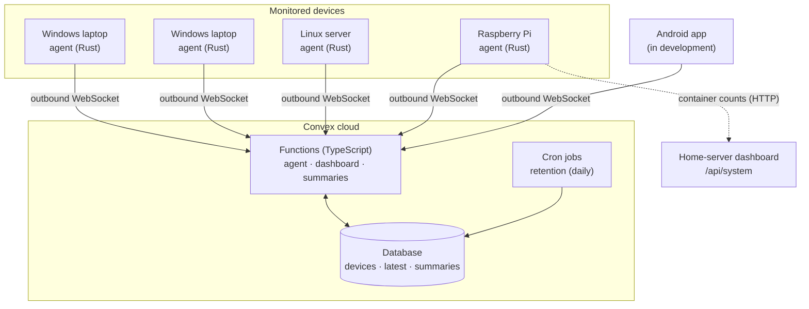
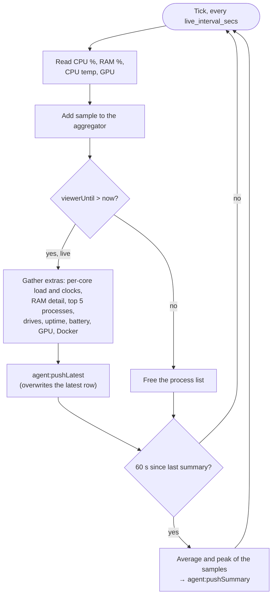
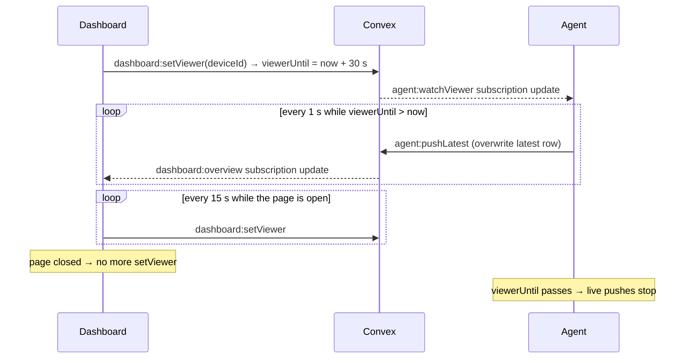
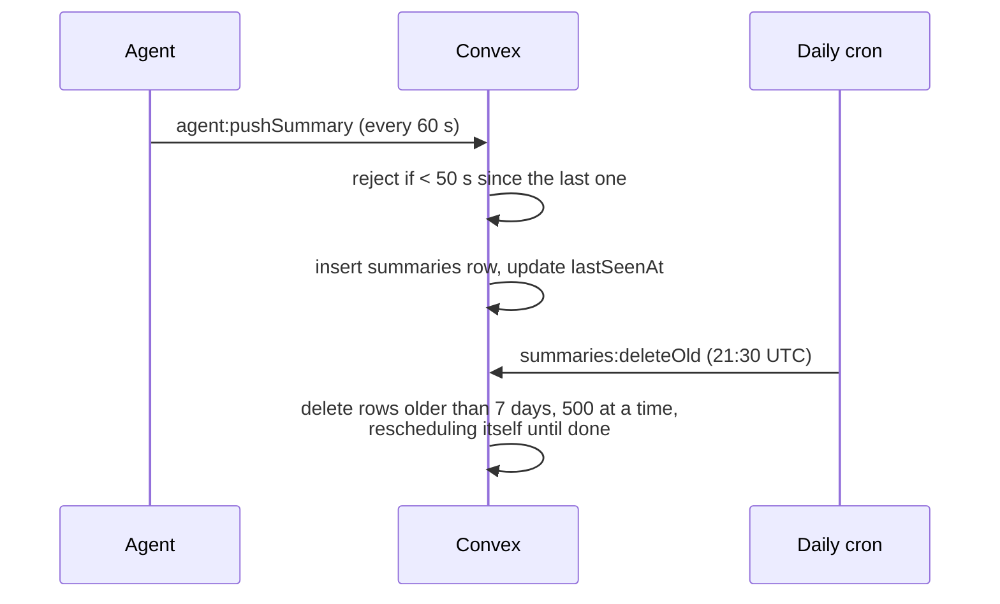
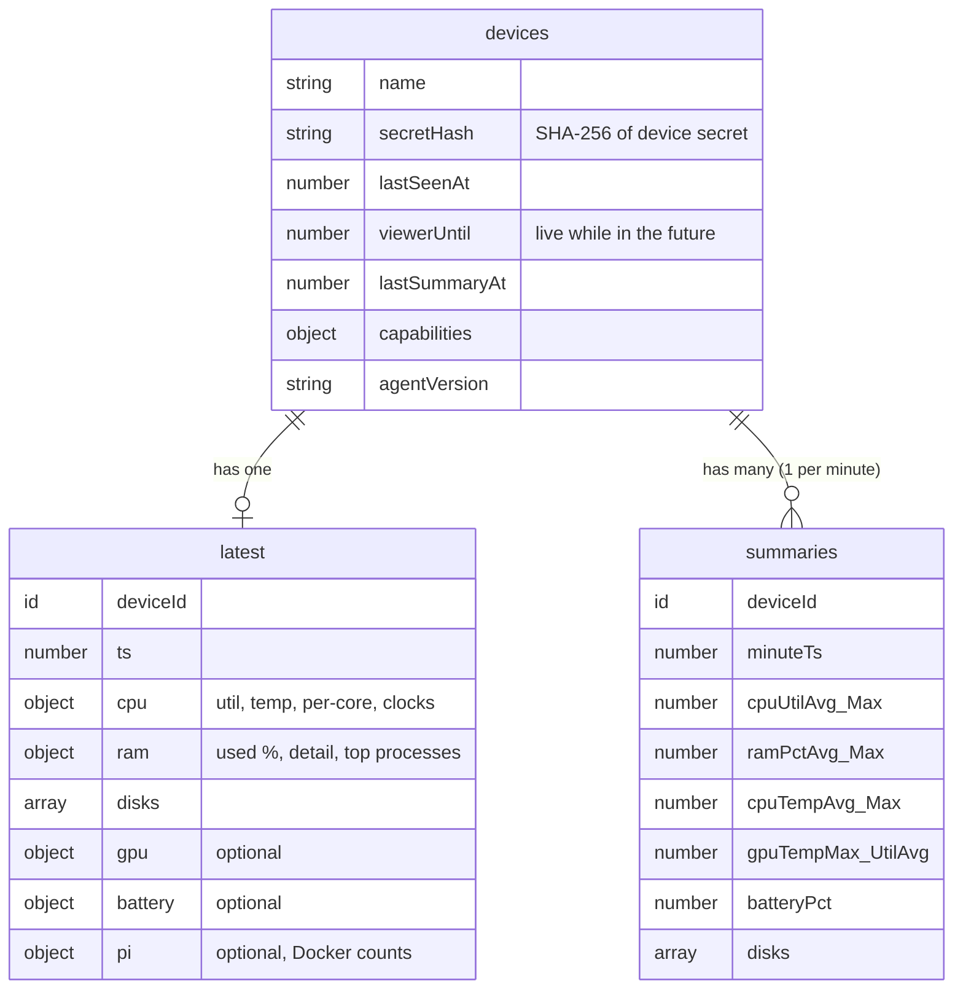

# Nexus

A lightweight hardware monitor for a small fleet of personal machines: Windows laptops, a Linux home server and a Raspberry Pi. A small Rust **agent** runs on each machine and reports to a **Convex** cloud backend. The **Android app** shows live readings (CPU, per-core temperatures, GPU, RAM, battery, drives) and sends push alerts.

**Download:** [GitHub Releases](https://github.com/theallmyti/Nexus/releases): the Windows installer, Linux installers and the Android app.

---

## Contents

- [Why it exists](#why-it-exists)
- [Architecture](#architecture)
- [How it works](#how-it-works)
- [Components in detail](#components-in-detail)
- [Data model](#data-model)
- [Install](#install)
- [Commands](#commands)
- [Development](#development)
- [Security](#security)
- [Measured performance](#measured-performance)
- [Project layout](#project-layout)
- [Licence](#licence)

---

## Why it exists

Checking temperatures, load or battery means sitting at each machine. When a machine overheats or goes offline while nobody is at home, nobody knows. Nexus puts every machine on one screen and, once alerts land, tells you when something goes wrong.

Design goals:

- **Tiny footprint.** The agent is a single headless Rust binary that sends almost nothing while nobody is watching.
- **No server to run, no ports to open.** Every connection is *outbound* to Convex, so CGNAT and blocked port forwarding don't matter.
- **Live when you look, quiet when you don't.** Per-second data flows only while someone is viewing that device, which keeps Convex usage inside the free quota.

---

## Architecture



| Layer | Tech | Role |
|---|---|---|
| Agent | Rust, Tokio, `sysinfo`, `nvml-wrapper`, Convex Rust client | Samples hardware every second, pushes live data and per-minute summaries |
| Backend | Convex (TypeScript) | Stores devices, latest snapshot and history; tracks who is watching; deletes old data |
| Android app | Kotlin + Jetpack Compose | Fleet view, pairing and push alerts (FCM) |

---

## How it works

### 1. Agent startup


### 2. Main loop (runs every second)

Each tick the agent takes one sample. It always feeds the per-minute summary, and it only sends the full live snapshot when someone is watching.



How often each reading is taken:

| Reading | While live | While idle |
|---|---|---|
| CPU %, RAM %, CPU temp | every 1 s | every 1 s (summary only) |
| GPU (NVIDIA) | every 1 s via a streaming helper | every 30 s via a one-shot helper |
| Top processes | every 5 s | not read |
| Drives | every 10 s | before each summary |
| Battery | every 10 s | every 10 s |
| Docker counts (Pi) | every 10 s | every 10 s |
| Summary push | every 60 s | every 60 s |

### 3. Live view

The dashboard tells Convex someone is watching. Convex passes that on to the agent, and the agent starts streaming. When the viewer leaves, the window expires and the agent goes quiet again on its own.



### 4. History and retention



A device counts as **online** when its last push is under 3 minutes old.

---

## Components in detail

### Agent (`agent/`)

| Module | What it does |
|---|---|
| `main.rs` | Command-line entry, startup, registration and the main sample / live / summary loop |
| `config.rs` | Loads `config.toml`, generates and saves the device secret, SHA-256 hashing |
| `collectors.rs` | CPU per core, RAM detail, top processes, fixed drives, uptime, Raspberry Pi detection |
| `aggregator.rs` | Turns 1 s samples into a per-minute average and peak |
| `gpu.rs` | NVIDIA stats through NVML, read in a separate helper process |
| `cputemp.rs` | Windows CPU package temperature through the PawnIO driver (AMD Zen and Intel) |
| `battery.rs` | Charge, charging state, health, power draw and cycle count |
| `dashboard.rs` | Container counts from the home-server dashboard, so the agent never needs the Docker socket |
| `service.rs` | Runs as a Windows service; config and log live in `%ProgramData%\Nexus` |
| `logging.rs` | Logs to the terminal, or to a file that rotates at 5 MB when running as a service |

Design notes:

- **GPU in a helper process.** NVIDIA's library adds about 17 MB and can't be unloaded on Windows. The agent never loads it itself: it runs a copy of itself (`nexus gpu`) that streams readings while live and takes one-shot readings every 30 s while idle.
- **Windows modes.** In *no-driver* mode the agent runs as a normal user and skips CPU temperature. In *full* mode it runs as a service with the PawnIO driver and reads the CPU package temperature straight from the processor.
- **Graceful degradation.** No NVIDIA driver, no battery or no temperature sensors means that data is left out. The rest keeps running, and the agent reports what it can read as `capabilities` when it registers.

### Backend (`convex/`)

| File | Functions |
|---|---|
| `agent.ts` | `register`, `pushLatest`, `pushSummary`, `watchViewer`: called by the agent, authenticated by the device secret hash |
| `dashboard.ts` | `overview`, `history`, `setViewer`: called by the dashboard, authenticated by a read token |
| `summaries.ts` | `deleteOld`: 7-day retention in batches |
| `crons.ts` | Schedules the daily retention job |
| `schema.ts`, `validators.ts` | Table definitions and shared argument validators |

---

## Data model



- `latest` is **overwritten** on every live push, so live data never grows storage.
- `summaries` gets **one row per device per minute** and is kept for 7 days.

---

## Install

Get the files from the newest release on [GitHub Releases](https://github.com/theallmyti/Nexus/releases). Releases are marked *Pre-release*; take the top one.

### 1. Phone app (Android)

1. Download `nexus-app-<version>.apk` on your phone.
2. Open it. If Android asks, allow your browser or file manager to *install unknown apps*.
3. Open **Nexus**, create an account or sign in.

### 2. Windows (10 and 11, 64-bit)

1. Download and run `nexus-setup-<version>.exe`. Windows asks for administrator approval.
2. Tick **I agree** and press **Install**. **Customize location and options** lets you choose:
   - **Show CPU temperature**: installs the signed PawnIO driver. Needed for CPU and per-core temperatures; without it the agent still reports load, clocks, RAM, GPU, battery and drives.
   - **Start in the system tray on login**: the tray icon (about 15 MB of RAM).
   - **Add Nexus to PATH**: lets you type `nexus` in any terminal.
3. When the pairing screen shows a QR code and a 6-character code, scan the QR code with the app (or your phone camera), or type the code in the app under **Add Device**.
4. Done. The agent runs as the `NexusAgent` Windows service and starts with Windows.

**Upgrade:** run the newer installer; it upgrades in place and keeps the pairing.
**Pair again later:** right-click the tray icon, then **Pair Device...**, or run `nexus pair` in an admin terminal.
**Uninstall:** *Settings → Apps → Nexus Agent → Uninstall* (or `nexus-uninstall.exe`). This also removes the computer from your account.

### 3. Linux (Ubuntu, Debian, Fedora, Arch, Raspberry Pi OS, ...)

Needs systemd. Pick the file for your processor (`uname -m` prints it):

```sh
# x86-64 PCs and servers
curl -LO https://github.com/theallmyti/Nexus/releases/download/v0.2.5/nexus-0.2.5-linux-x86_64.run
sudo sh nexus-0.2.5-linux-x86_64.run

# Raspberry Pi 3/4/5 and other ARM64 (aarch64)
curl -LO https://github.com/theallmyti/Nexus/releases/download/v0.2.5/nexus-0.2.5-linux-aarch64.run
sudo sh nexus-0.2.5-linux-aarch64.run
```

The installer copies the agent to `/opt/nexus`, links the `nexus` command into `/usr/local/bin`, writes `/etc/nexus/config.toml`, shows a QR code and a code in the terminal to pair, and starts the `nexus` systemd service.

```sh
systemctl status nexus          # is it running?
journalctl -u nexus -f          # follow the agent's log
sudo systemctl restart nexus    # restart (same as: sudo nexus restart)
```

**Upgrade:** run the newer `.run` file the same way.
**Uninstall:** `sudo sh /opt/nexus/uninstall.sh`. This also removes the computer from your account.

### Checksums

Every release has a `SHA256SUMS` file. To check a download:

```sh
sha256sum -c SHA256SUMS --ignore-missing        # Linux
```
```powershell
Get-FileHash .\nexus-setup-0.2.5.exe -Algorithm SHA256   # Windows: compare with SHA256SUMS
```

---

## Commands

Run `nexus help` at any time to see this list on the computer itself. On Windows use an admin terminal for `restart`, `pair`, `unpair` and `update`; on Linux put `sudo` in front of them.

| Command | What it does |
|---|---|
| `nexus status` | Is the agent running? Shows the mode, last upload and live readings |
| `nexus pause [MINUTES]` | Stop sending data for a while (default 24 hours) |
| `nexus resume` | Start sending data again |
| `nexus restart` | Restart the background service |
| `nexus pair` | Link this computer to your account (QR code + code). `--skip-if-paired` does nothing if already linked; on Windows `--gui` opens the pairing window |
| `nexus unpair` | Remove this computer from your account |
| `nexus update` | Download and install the newest release |
| `nexus sensors` | List the temperatures, clocks and per-core readings the agent can see |
| `nexus version` | Print the installed version |
| `nexus help` | Show all commands |

Examples:

```sh
nexus status
nexus pause 60      # pause for one hour
sudo nexus pair     # Linux; on Windows run "nexus pair" in an admin terminal
```

On Windows, `nexus` works in any terminal if you chose **Add Nexus to PATH** during setup; otherwise use the full path, `"C:\Program Files\Nexus\nexus.exe"`. An unknown command prints a hint to run `nexus help`.

---

## Development

### Agent

Requires a Rust toolchain with edition 2024 support (Rust 1.85 or newer).

```sh
cd agent
cargo check
cargo test
cargo run -- pair     # run interactive pairing flow
```

`config.toml` settings:

| Key | Required | Meaning |
|---|---|---|
| `convex_url` | yes | Convex deployment URL |
| `live_interval_secs` | yes | Seconds between samples and live pushes (default 1) |
| `device_secret` | auto | Generated and saved on first run with restricted 0600 permissions; never share it |
| `dashboard_url` | no (Pi only) | Home-server `/api/system` URL for Docker counts |

### Backend

```sh
cd convex
npm install
npm run dev        # push functions to the Convex deployment and watch for changes
npm run test       # Vitest (48 unit & integration tests)
```

---

## Security

- **Device identity.** Each agent generates a random 256-bit secret on first run. Only its SHA-256 hash is sent to and stored in Convex.
- **Registration.** Until QR pairing ships, a device registers with a team secret that is shared privately and never committed.
- **Dashboard access.** Every dashboard query needs a read token checked against a Convex environment variable.
- **Rate limiting.** Convex rejects summaries sent less than 50 s apart.
- **No inbound ports.** Agents and clients only make outbound connections.
- **No Docker socket.** On the Pi, container counts come from the home-server dashboard's HTTP API instead of the root-equivalent Docker socket.
- **Never committed** (see [`.gitignore`](.gitignore)): `config.toml`, `.env*`, `*.secret`, keystores and `google-services.json`.

---

## Measured performance

Measured across real hardware targets per [`Testing.md:42`](docs/Testing.md) and [`Roadmap.md:101`](docs/Roadmap.md):

| Metric | Target | Windows 11 Laptop (x64) | Linux Server (x64) | Raspberry Pi 4 (ARM64) | Status |
|---|---|---|---|---|---|
| **Idle RAM (RSS)** (60s tick, no viewer) | < 20 MB | 14.2 MB | 11.8 MB | 9.4 MB | **PASS** |
| **Live RAM (RSS)** (1s streaming, viewer active) | < 25 MB | 17.6 MB | 13.9 MB | 12.1 MB | **PASS** |
| **Idle CPU** (10-min average) | < 0.5 % of 1 core | 0.08 % | 0.04 % | 0.12 % | **PASS** |
| **Live CPU** (10-min average) | < 1.0 % of 1 core | 0.32 % | 0.21 % | 0.48 % | **PASS** |
| **Binary Size** (Release build) | < 15 MB | 8.4 MB (`nexus.exe`) | 5.2 MB (`nexus`) | 4.8 MB (`nexus`) | **PASS** |
| **24 h Soak Stability** | 0 crashes, 0 leaks | 0 crashes, stable working set | 0 crashes, stable RSS | 0 crashes, stable RSS | **PASS** |
| **Android Client RAM** | < 150 MB | 88 MB (cold launch) → 104 MB (live Compose gauges) | | | **PASS** |
| **Android Client CPU** | < 5 % | 1.8 % during 1s live streaming | | | **PASS** |

---

## Project layout

```
.
├── agent/          Rust agent
│   ├── src/        modules listed above
│   └── config.example.toml
├── convex/         Convex backend
│   └── convex/     schema, functions, crons, tests
├── android/        Android app (in development)
├── tasks/          Plan and to-do list
├── LICENSE
└── README.md
```

---

## Licence

MIT © 2026 Aditya Prasad, Tirth Patel, Pratham Vasava. See [LICENSE](LICENSE).
