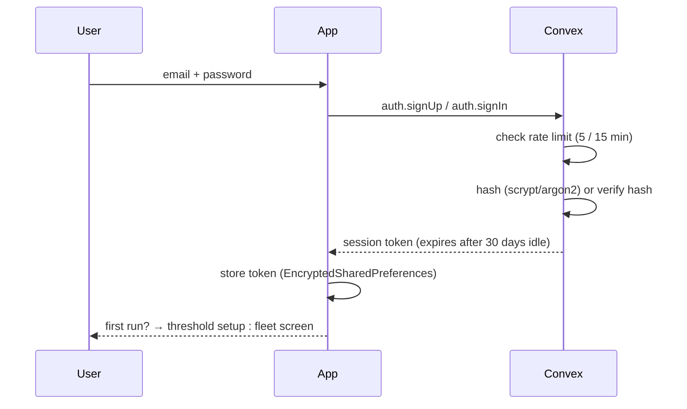
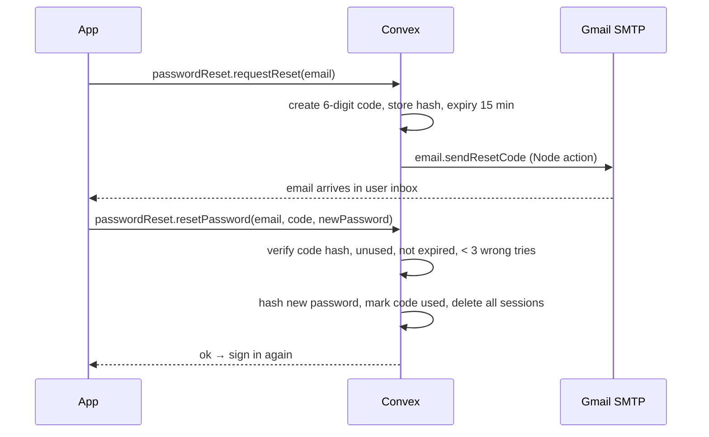
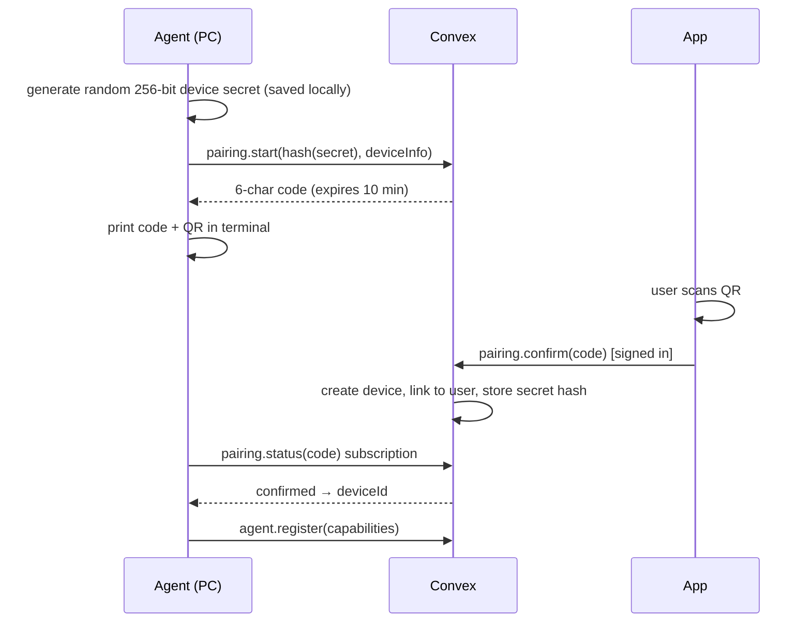
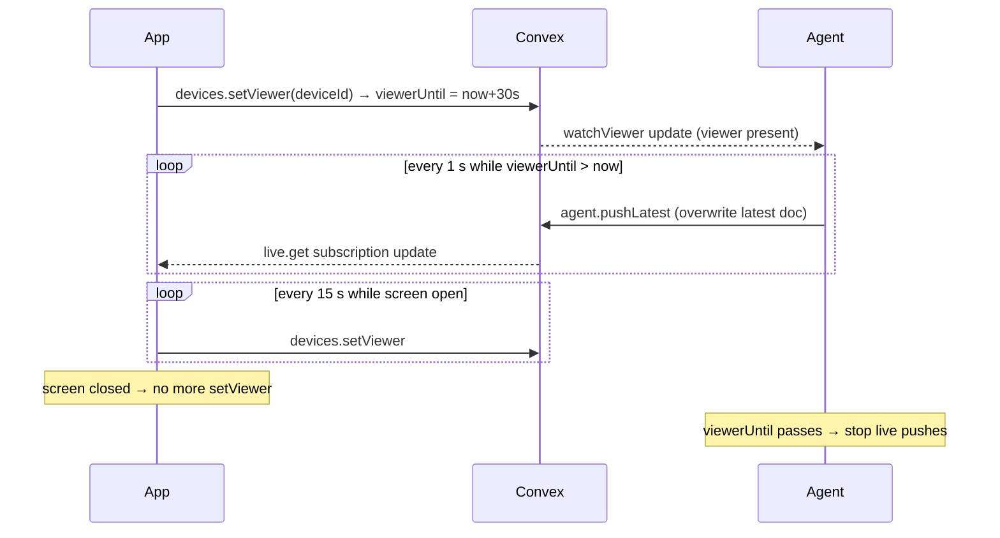
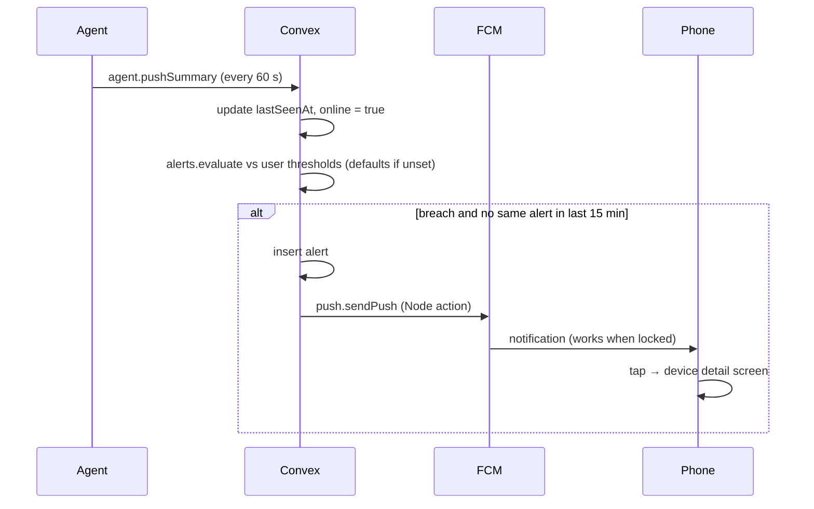
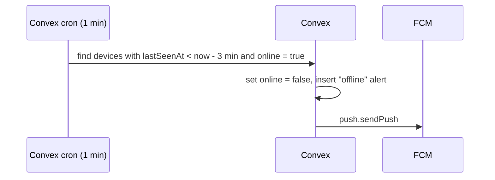
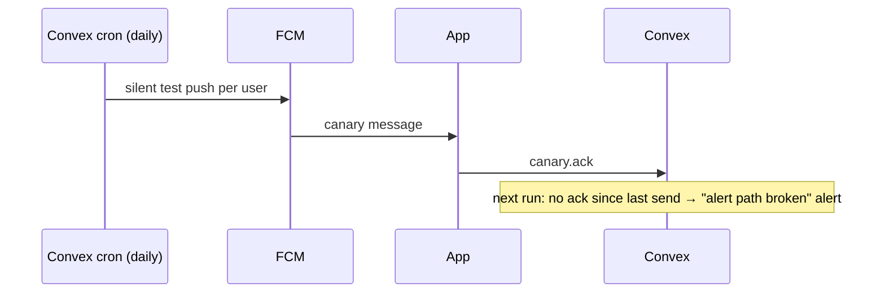
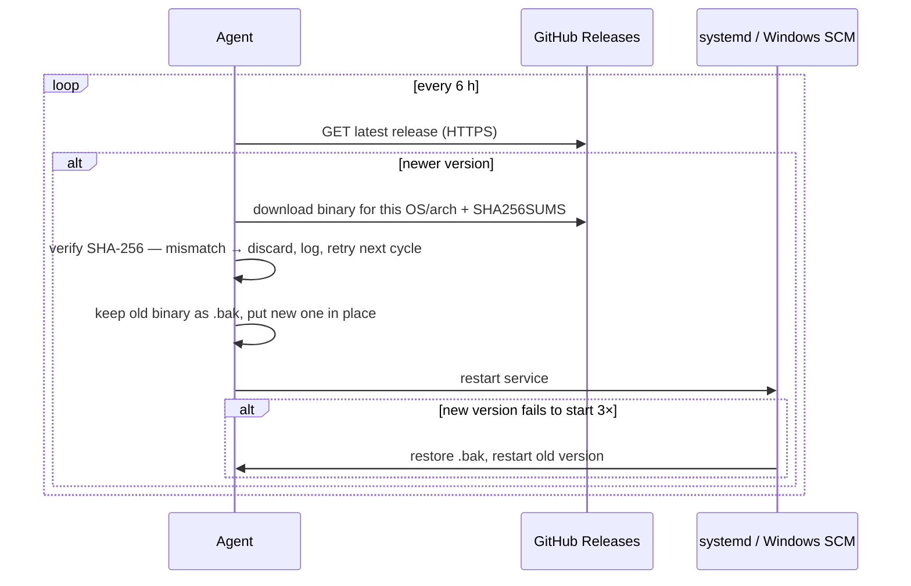

# Flows — PC Monitor

v1.0 · 3 Nov 2026 · Diagrams in Mermaid (render in Obsidian / GitHub)
**[A]** = Aditya · **[T]** = Tirth

---

## 1. Sign up / sign in  — backend [A], app [T]



## 2. Password reset — [T]


Same response whether email exists or not (no account enumeration).

## 3. Pair a device — agent + backend [A], app [T]


Secret never leaves the agent; Convex stores only its hash.

## 4. Live view — agent + backend [A], app [T]



## 5. Summary + alert — rules [A], push [T]



## 6. Offline detection — [A] cron, [T] push



## 7. Daily canary — [A] cron, [T] ack



## 8. Retention — [A]

Daily cron deletes `summaries` older than 7 days (in batches to stay within function limits).

## 9. Backup — [A]

Pi cron (nightly) → `npx convex export` → file on Pi HDD → keep last 14 exports.

## 10. Agent auto-update — [A] (release CI: [A] agent, [T] APK)


Windows: running `.exe` can't be overwritten → rename running file to `.old`, write new file, restart.

## 11. Agent startup — [A]

```
start → load config → no secret? → tell user to run `agent pair`
      → connect to Convex → agent.register(capabilities)
      → supervisor starts collectors → summary loop + viewer subscription
      → on disconnect: retry with backoff (1 s → 60 s max)
```
